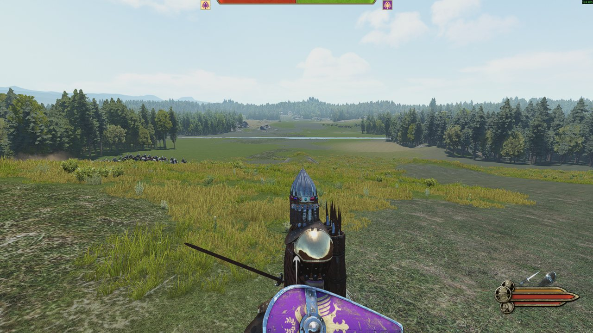
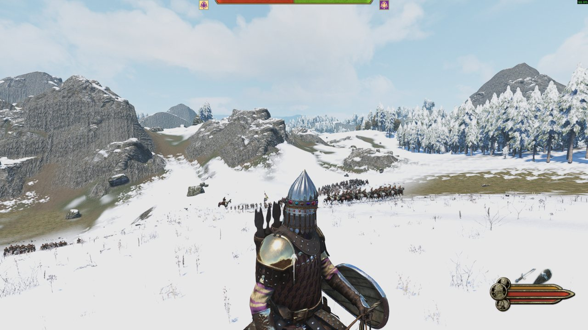
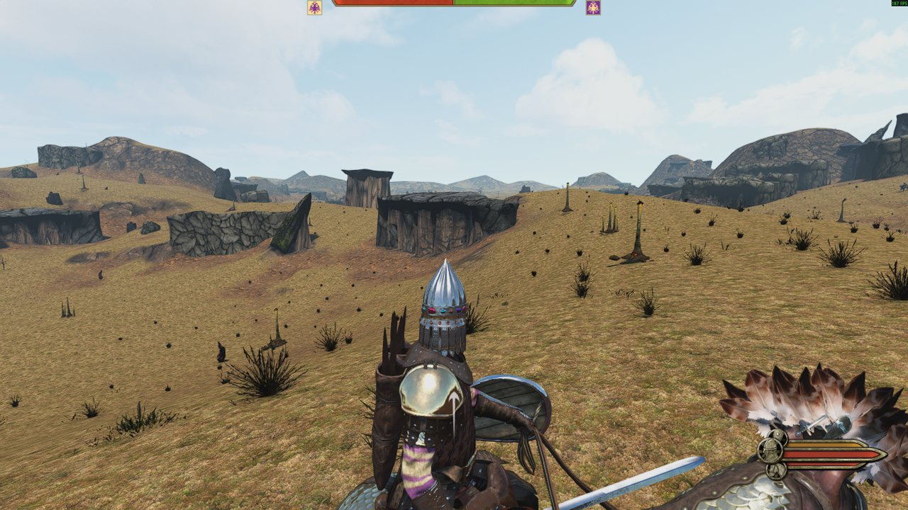

# Procedural Battlefields

A Bannerlord mod that makes a new battle map for every field battle in the campaign.

When a battle starts, the mod looks at the campaign map around your party: plains, steppe or desert, how many
mountains and trees are nearby, whether there is a river or a coast. Then it builds a map to match while the loading
screen is up. That takes about 2 seconds on my PC. You never fight on the same map twice.


| | |
|---|---|
|  |  |
|  |  |

What I'm going for is battles that stay fresh and where the ground matters: cavalry should love the open steppe and
hate a mountain pass. It's not there yet (see "What's missing"), but the maps already generate and play.

## Status

Early. It works in my own campaign tests on Bannerlord v1.4.8, and I have not tried any other version. There is no
download yet, so for now you build it from source. It is not on the Steam Workshop.

## What you get

- Ten kinds of map: ridge, valley, hill, river crossing, forest clearing, mountain pass, coastal bluff, broken ground,
  desert mesas, and a mountain shelf with a drop you can fall off.
- Terrain shaped with noise and erosion, so it reads as land and not as random bumps.
- Rocks, trees, grass and bushes from the game's own maps, placed the way those maps place them. Rocks are fitted to
  the ground from their real 3D shape so they don't float.
- Navmesh, spawn lines and AI markers, so the armies deploy and fight like on any other map.
- Snow in winter.

## What's missing

- Only plains, steppe and desert have their own look. Everywhere else, including the snowy north, gets a plains map,
  and snow only shows up in winter. A proper harsh north is the next thing I want.
- I haven't tested night battles, rain, or big battles with reinforcement waves.
- I haven't checked how fair the two starting positions are.
- In steep valleys a few rocks still end up partly buried in the hillside.
- The game keeps a map's files locked until you quit, so the mod can make 60 new maps per biome per session. After
  that it falls back to the game's own maps until you restart.
- Sieges, villages, hideouts and sea battles are untouched.

## Requirements

To play: Bannerlord v1.4.8, nothing else. No Harmony, no other mods. It doesn't touch your saves, so you can add or
remove it in the middle of a campaign.

To build: Windows, Python 3.10+, the .NET SDK, and the game installed.

## Build and install

```powershell
git clone --recursive https://github.com/theartur2000/bannerlord-procedural-battlefields
cd bannerlord-procedural-battlefields
pip install -r requirements.txt
$env:BANNERLORD_DIR = "<your game folder>"       # skip this if the game is in the default Steam folder

dotnet build mod/GenFields/src/GenFields.csproj -c Release -p:BannerlordDir="$env:BANNERLORD_DIR" -o build
python tools/livedata.py                          # once, takes a few minutes
python tools/install.py --dll build --live        # with the game closed
```

Then tick "GenFields" in the launcher.

`livedata.py` reads rock shapes and ground textures out of your own game install. That is why there are no game
files in this repo, and why you have to run it once yourself.

To uninstall: `python tools/install.py --remove`. The installer only ever writes inside `Modules\GenFields`. It takes
about 250 MB.

## While playing

When a battle starts on a generated map, the mod prints which kind of map it is. If you see something broken, stand
on it and press F10: that saves your position and a screenshot, which makes it easy to find and fix.

To switch the mod off without uninstalling, put an empty file called `genfields_nolive.txt` in `Modules\GenFields`.
The log is `genfields_log.txt` in the same folder.

## How it works

The game asks its "scene model" which map to load for a battle. The mod wraps that model. For a land battle it reads
the terrain types around your party, turns them into a few numbers (biome, ruggedness, forest, water), picks a kind
of map, generates it, and hands the game the name of the new scene. Everything else is passed through to the game.

The generator is plain C# with no engine calls (`mod/GenFields/src/gen`). It writes the three files a Bannerlord
scene needs: `scene.xscene`, `terrain.bin` and `navmesh.bin`.

Two things about the engine made this harder than it sounds:

- A scene folder has to exist when the game starts, or the game won't load it. Empty files are enough, though.
- Once a scene has been loaded, the game keeps its `terrain.bin` open until you quit.

So the mod ships 64 scene folders per biome, most of them empty, and fills a fresh one for each battle. They get
emptied again the next time you start the game.

I first wrote the generator in Python (`tools/procgen.py`), where a map took 20 to 40 seconds. The C# version does
the same steps in under 2 seconds. Most of that came from running loops in parallel, preparing data ahead of time,
and replacing a few slow operations with cheaper ones. `mod/GenFields/gen_cli` builds the generator as a command-line
program that prints how long each step takes.

The full story, with every measurement and dead end, is in [docs/BATTLEFIELDS.md](docs/BATTLEFIELDS.md).

## The tools

These are Python scripts built on my [Bannerlord editor-free SDK](https://github.com/theartur2000/bannerlord-editor-free-sdk),
which is included as a submodule. Run any of them with `-h` for the options.

| script | what it does |
|---|---|
| `tools/procgen.py` | the Python generator: makes one map from settings like `--biome --kind --rugged --forest --seed`, with a top-down preview |
| `tools/livedata.py` | pulls the data the in-game generator needs out of your install |
| `tools/install.py` | installs or removes the mod, and can add single test maps |
| `tools/pool.py` | pre-generates 24 maps the mod can fall back on |
| `tools/fieldmap.py` | draws a top-down picture of any Bannerlord battle map |
| `tools/lineup.py` | makes a test map with every rock of a biome standing in a row |
| `tools/generate.py` | my first attempt, kept for reference: cuts the map out of the campaign map's own heights |
| `tools/test.ps1` | starts the game by itself, runs a battle on a map, takes screenshots and quits |
| `tools/bl2field.py` | see below |

To make one map by hand and try it in Custom Battle:

```powershell
python tools/procgen.py --biome Plain --kind valley --rugged 0.8 --forest 0.25 --seed 311 --name my_valley --preview my_valley.png
python tools/install.py --dll build --scene my_valley
```

If you change how maps look, change both generators. The Python one is easier to experiment in.

## A map made from another game's assets

The generator doesn't care where its rocks and textures come from. `tools/bl2field.py` builds a map using only
Borderlands 2 models and textures, with nothing from Bannerlord on it. You need your own copy of Borderlands 2 and a
umodel export of it. None of those files are in this repo.



## Credits

- TaleWorlds made Bannerlord. The game and everything in it is theirs.
- The erosion is the stream-power method from Braun and Willett (2013). The talks and articles I learned from are
  listed at the end of [docs/BATTLEFIELDS.md](docs/BATTLEFIELDS.md).
- I built this with Claude Code. I do the design and the playtesting, and it writes most of the code.

## License

MIT.
